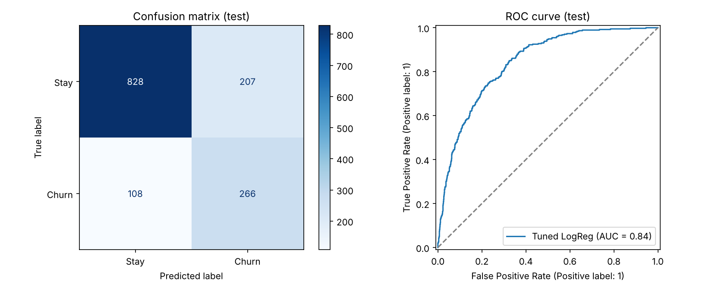
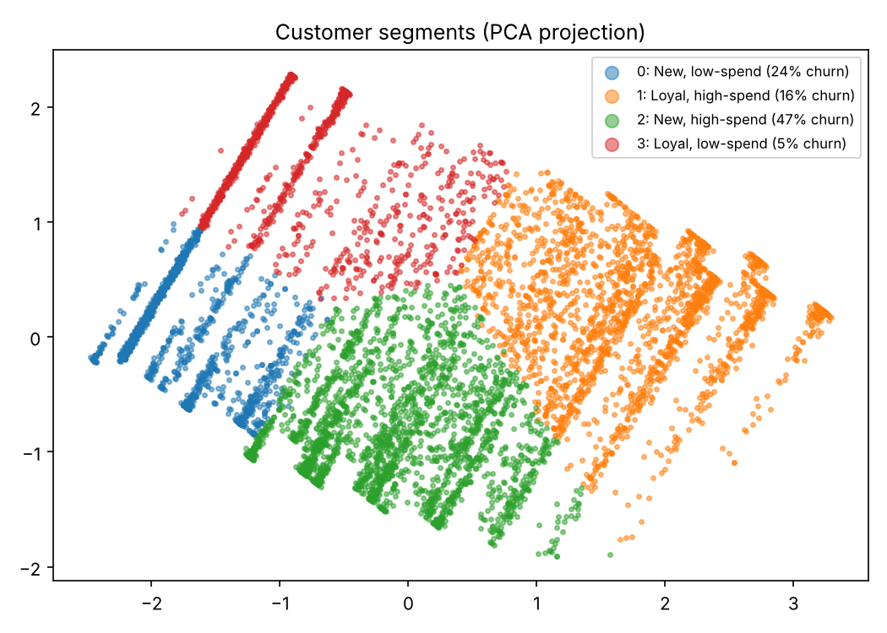

# Customer Churn Prediction & Segmentation

An end-to-end machine learning project that predicts which telecom customers are likely to cancel (**supervised learning**), groups customers into segments (**unsupervised learning**), and turns both into retention recommendations a business could act on.

**Tech stack:** Python · Pandas · NumPy · Scikit-learn · Matplotlib/Seaborn · Jupyter · Streamlit

## Results

| Metric (held-out test set, 1,409 customers) | Score |
|---|---|
| ROC-AUC | **0.84** |
| Recall (churners caught) | **71%** |
| Precision | 56% |
| F1 | 0.63 |
| Accuracy | 78% |

- Compared **Logistic Regression, Random Forest and Gradient Boosting** using 5-fold stratified cross-validation. All three scored about 0.85 ROC-AUC, so I chose the interpretable Logistic Regression and tuned it with `GridSearchCV`.
- I set the **decision threshold** from training data to favor recall, because missing a churner costs more than sending an unneeded retention offer.
- **Most important churn drivers:** tenure, contract type and internet service type.

### Customer segments (K-Means, k = 4)

| Segment | Customers | Avg tenure | Avg monthly bill | Churn rate |
|---|---|---|---|---|
| New, high-spend | 2,315 | 15 mo | $78 | **47%** |
| New, low-spend | 1,557 | 10 mo | $30 | 24% |
| Loyal, high-spend | 2,144 | 57 mo | $92 | 16% |
| Loyal, low-spend | 1,027 | 55 mo | $32 | 5% |

**Key insight:** new, high-spend customers on month-to-month contracts make up about a third of the customer base and churn at nearly 1 in 2. A discount for switching to an annual contract, aimed at this segment, is the highest-impact retention lever.




## What's inside

```
├── data/Telco-Customer-Churn.csv     # IBM Telco Customer Churn dataset (7,043 rows)
├── notebooks/churn_analysis.ipynb    # Full walkthrough: cleaning → EDA → models → segments → insights
├── src/
│   ├── data_prep.py                  # Cleaning, feature engineering, preprocessing pipeline
│   ├── train.py                      # Model comparison, tuning, evaluation, saved model
│   └── segment.py                    # K-Means segmentation (elbow + silhouette)
├── app.py                            # Streamlit demo: enter a customer and get their churn risk
├── models/churn_model.joblib         # Trained pipeline + decision threshold
└── reports/                          # metrics.json, segments.json, figures
```

## Approach

1. **Data cleaning:** converted `TotalCharges` from text to numbers. Its 11 blank values all belong to new customers with zero tenure, so I set them to 0 instead of filling them with an average.
2. **Feature engineering:** added `AvgMonthlySpend`, `NumServices` (number of add-on services) and `TenureGroup` buckets.
3. **Leakage-safe preprocessing:** imputation, scaling and one-hot encoding happen inside a scikit-learn `Pipeline`, so they're fitted only on the training folds.
4. **Imbalanced classes:** only 26.5% of customers churn, so I judged models by ROC-AUC, recall and F1 instead of accuracy.
5. **Explainability:** permutation importance on the test set.
6. **Segmentation:** K-Means on scaled tenure, monthly charges and service count, with *k* chosen by elbow and silhouette scores and the clusters visualized with PCA.

## Run it

```bash
pip install -r requirements.txt
python -m src.train        # trains the model, writes metrics and figures
python -m src.segment      # builds the customer segments
streamlit run app.py       # interactive demo
```

Or open `notebooks/churn_analysis.ipynb` in Jupyter or Google Colab.

## Next steps
- Try XGBoost or LightGBM and use SHAP values to explain individual predictions
- Set the threshold from the actual cost of a retention offer versus a lost customer
- Deploy the Streamlit app on Streamlit Community Cloud

**Dataset:** [IBM Telco Customer Churn](https://github.com/IBM/telco-customer-churn-on-icp4d)
